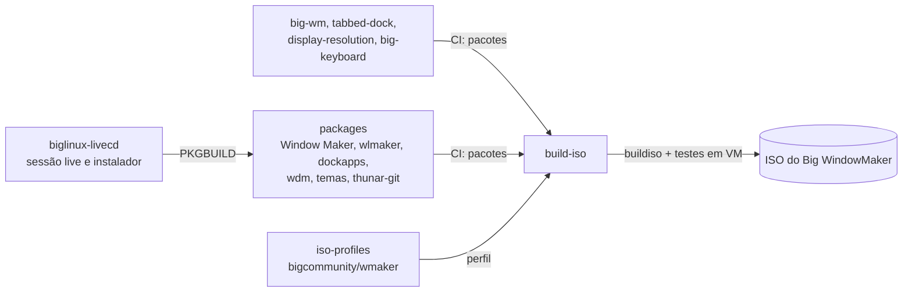

<p align="center">
  
</p>

<h1 align="center">iso-profiles — edição Big WindowMaker</h1>

<p align="center">
  <b>O perfil da ISO do Big WindowMaker (<code>bigcommunity/wmaker</code>).</b><br>
  Fork de <a href="https://github.com/big-comm/iso-profiles">big-comm/iso-profiles</a>, os perfis das edições da BigCommunity.
</p>

<p align="center">
  
  <a href="https://github.com/big-comm/iso-profiles"></a>
  
</p>

<p align="center">
  <a href="#a-edição-big-windowmaker">A edição</a> ·
  <a href="#arquivos-da-edição-e-links-para-shared">Arquivos e links</a> ·
  <a href="#sessão-live-e-tela-de-login-wdm">Live e wdm</a> ·
  <a href="#pacotes-da-edição">Pacotes</a> ·
  <a href="#da-lista-de-pacotes-à-iso">Como vira ISO</a> ·
  <a href="#capturas-da-iso">Capturas</a> ·
  <a href="#testar">Testar</a> ·
  <a href="#contribuir">Contribuir</a> ·
  <a href="#créditos">Créditos</a> ·
  <a href="#bigcommunity-iso-profiles">Documentação original (English)</a>
</p>

## A edição Big WindowMaker

`bigcommunity/wmaker/` descreve a ISO do Big WindowMaker: o desktop
Window Maker (X11) e wlmaker (Wayland) do
[big-wm](https://github.com/big-windowmaker/big-wm) sobre a base BigLinux /
BigCommunity / Manjaro, com a tela de login wdm (WINGs Display Manager) na
sessão live e no sistema instalado e o instalador Calamares com o perfil
`bigwindowmaker` do [biglinux-livecd](https://github.com/big-windowmaker/biglinux-livecd).

| | |
|---|---|
| Máquina live | `big-windowmaker` |
| Usuário live | `bigwindowmaker`, senha `big` (só na live) |
| Tela de login | wdm, na live e no sistema instalado; LightDM instalado e desabilitado |
| Sessões | *Big WindowMaker Live* (assistente + Window Maker, só na live), Big WindowMaker (X11) e Big WindowMaker Wayland |
| Instalador | Calamares, perfil `bigwindowmaker` (escolhido por `live-overlay/etc/biglinux-livecd/profile`) |
| Nome do sistema | "Big WindowMaker, based on BigLinux" (`big-wm-name`) |
| Boot | GRUB da live com o tema do Big WindowMaker; no sistema instalado, `grub-theme-big-wm` e `plymouth-theme-big-wm` |

## Arquivos da edição e links para `shared/`

> [!WARNING]
> Boa parte de `bigcommunity/wmaker/` é **link simbólico para `shared/`**,
> que vale para **todas as edições**: um editor que segue o link grava no
> arquivo comum. Confira com `ls -l` antes de gravar; para algo só do Big
> WindowMaker, crie o arquivo dentro da edição.

| Caminho em `bigcommunity/wmaker/` | Tipo | O que define |
|---|---|---|
| `Packages-Desktop` | arquivo da edição | os pacotes do desktop: sessões, Window Maker, wlmaker, dockapps, temas, aplicativos |
| `profile.conf` | arquivo da edição | `displaymanager="wdm"`, máquina, usuário e senha live, serviços do sistema instalado e os desligados na live |
| `Desktop-remove`, `Root-remove` | arquivos da edição | o que sai das listas comuns (`vim`, `mesa-demos`, `plymouth-theme-community`, `bigcommunity-name`...) |
| `Packages-Root`, `Packages-Live`, `Packages-Mhwd`, `user-repos.conf` | **links** para `../../shared/` | base, pacotes só da live (Calamares, `biglinux-livecd`), drivers e repositórios: iguais em todas as edições |
| `live-overlay/etc/wdm/` | arquivos da edição | `wdm-config` da live (sessão padrão `x11/big-wm-live`) e `live-help.txt` (ajuda F1 com usuário e senha) |
| `live-overlay/usr/share/xsessions/big-wm-live.desktop` | arquivo da edição | a sessão *Big WindowMaker Live*, que executa `startbiglive` |
| `live-overlay/etc/biglinux-livecd/profile` | arquivo da edição | o perfil `bigwindowmaker` do instalador |
| `live-overlay/etc/xdg/autostart/big-wm-locker.desktop`, `live-overlay/etc/issue` | arquivos da edição | sem bloqueio de tela automático na live; nome no console |
| `live-overlay/usr/share/grub/` | `cfg/*.cfg` são **links** para `shared/`, exceto `kernels.cfg` e `profile.cfg`; `themes/` e `locales/` são da edição | o menu do GRUB da live com o nome e o tema do Big WindowMaker |
| `grub-i18n/gerar.sh` | arquivo da edição | regenera `kernels.cfg` e os `.mo` da edição a partir de `shared/` |
| `live-overlay/usr/{bin,lib}`, `live-overlay/usr/share/{calamares,libalpm}`, `live-overlay/etc/{fstab,localtime,systemd,pacman.conf}` | **links** para `shared/` | arquivos comuns da live |
| `root-overlay/etc/` | arquivos da edição (exceto `default/grub` e `pacman.d/mirrorcdn`, **links**) | `pacman.conf` com `IgnorePkg = windowmaker`, `default/grub.d/big-wm-theme.cfg`, `plymouth/plymouthd.conf`, configuração do LightDM, `mkinitcpio.conf`, `pamac.conf` |
| `desktop-overlay/etc/` | arquivos da edição (exceto `default`, `environment` e `pam.d`, **links**) | `gtk-3.0`/`gtk-4.0` e Kvantum para programas como root, firewall (`ufw`), ModemManager sob demanda e drop-ins de serviços do usuário |
| `desktop-overlay/usr` | **link** para `shared/` | arquivos comuns do desktop |

Para listar os links da edição e para onde apontam:

```sh
find bigcommunity/wmaker -type l -printf '%p -> %l\n'
```

## Sessão live e tela de login (wdm)

> [!NOTE]
> O wdm na live vale a partir da próxima ISO (perfil de 13/11/2026). As
> ISOs publicadas até 12/11 usam LightDM com login automático e o usuário
> `community` (senha `big`).

- `profile.conf` tem `displaymanager="wdm"`: o manjaro-tools habilita o
  `wdm.service` na imagem. O wdm não tem login automático.
- A tela abre na lista de usuários com **bigwindowmaker** escolhido; a senha
  é **big** e F1 mostra a ajuda (`live-help.txt`, em português e inglês).
- A sessão padrão da live é **Big WindowMaker Live**
  (`x11/big-wm-live`): o `startbiglive` do `biglinux-livecd` abre o
  assistente (idioma, teclado, tema) e depois o Window Maker. As sessões X11
  e Wayland normais também aparecem na lista.
- O `wdm-config` da live é o do pacote
  ([packages/wdm](https://github.com/big-windowmaker/packages/tree/main/wdm))
  com a sessão padrão e a ajuda trocadas; o sistema instalado usa o do pacote.
- Na instalação, o módulo `services` do Calamares (perfil `bigwindowmaker`)
  habilita o `wdm` antes dos outros gerenciadores de login. O LightDM e o
  slick-greeter continuam instalados e desabilitados (o módulo
  `displaymanager` do Calamares os configura); para voltar a eles no sistema
  instalado: `sudo systemctl enable --force lightdm`.

## Pacotes da edição

`Packages-Desktop` tem 268 pacotes, agrupados por comentários. Os do Big
WindowMaker vêm do repositório local montado pelo
[build-iso](https://github.com/big-windowmaker/build-iso) com os artefatos
de CI dos repositórios da organização; o resto, dos repositórios
BigCommunity, BigLinux e Manjaro.

| Grupo | Pacotes |
|---|---|
| Sessões e desktop | `big-wm-session`, `big-wm-wayland`, `big-wm-themes`, `big-wm-name`, `big-wm-tabbed-dock`, `big-wm-display-resolution`, `big-wm-lockscreen`, `big-keyboard`, `wmake-zones`, `windowmaker`, `wlmaker` |
| Aparência | `onestepback-gtk-theme` (GTK), `qtstep-kvantum` e `kvantum-qt5` (Qt), `retrothemes-firefox` (Firefox), `gtk-nocsd`, `grub-theme-big-wm`, `plymouth-theme-big-wm` |
| Dockapps | padrão do Dock: `wmclock`, `wmcpuload`, `wmmemload`, `wmnet`, `wmsystemtray`, `wmpulsemixer`; mais 28 em Aparência > Dockapps (`wmcube`, `wmweather`, `wmcliphist`, `wmglobe`, `wmeyes`...) e o `wmix` |
| Serviços da sessão | `picom`, `polkit-gnome`, `rofi`, `snixembed`, `xss-lock`, `xsecurelock`, `gtklock`, `i3lock`, `fprintd`, `ufw` |
| Tela de login | `wdm`; `lightdm` e `lightdm-slick-greeter` (desabilitados) |
| Arquivos | `thunar-git` (master do Xfce, com o `libxfce4ui` 4.21 como dependência) e os plugins do Thunar, `tumbler`, `catfish`, `xarchiver` |
| Aplicativos | Firefox, LibreOffice, Kate, Papers, Spectacle, BigCam, Steam, apps do BigLinux (`biglinux-settings`, `big-pkg-installer`, `ashyterm`...) |

`Desktop-remove` tira das listas comuns `mesa-demos`, `lib32-mesa-demos`,
o `vim`/`vi` e as bibliotecas do FFADO; `Root-remove` tira
`plymouth-theme-community` e `bigcommunity-name`, que trocariam o tema do
Plymouth e o nome do sistema a cada atualização.

O `root-overlay/etc/pacman.conf` é o `shared/pacman.conf` mais
`IgnorePkg = windowmaker`: o pamac trocava o `windowmaker` do Big WindowMaker
pelo do `[extra]` e removia a sessão.

## Da lista de pacotes à ISO



O [build-iso](https://github.com/big-windowmaker/build-iso) junta os pacotes
dos outros repositórios num repositório local, confere que este perfil
resolve (simulação do pacman), roda os testes deste repositório, gera a ISO
com o motor da BigLinux e a inicia em máquinas virtuais (BIOS e UEFI): login
pelo wdm na live, sessão Window Maker, instalação pelo Calamares e login no
sistema instalado. O lint do build-iso também confere os links simbólicos da
edição (`scripts/check-symlinks.sh`) e que os pacotes do repositório local
estão em `Packages-Desktop`.

## Capturas da ISO

ISO de teste (Alpha), máquina virtual, 06/11/2026:

| | |
|---|---|
|  |  |
| GRUB da ISO | Sessão live |
|  |  |
| Login: X11 ou Wayland | Sistema instalado, sessão Wayland |

## Testar

```sh
python -m pytest tests     # 76 testes, menos de 1 s
```

| Arquivo | O que garante |
|---|---|
| `test_grub_contracts.py` | menu do GRUB da live (comum a todas as edições): argumentos de boot, módulos, entradas, temas |
| `test_wmaker_grub_nome.py` | a entrada 1 diz "Big WindowMaker"; `kernels.cfg` e catálogos da edição em dia com o `shared/` (senão, rode `grub-i18n/gerar.sh`) |
| `test_wmaker_boot_theme.py` | temas do GRUB e do Plymouth do sistema instalado |
| `test_wmaker_login_live.py` | login da live pelo wdm: `displaymanager`, usuário e senha, sessão padrão e ajuda |
| `test_wmaker_nome.py` | nome do sistema (`big-wm-name` no lugar do `bigcommunity-name`) e perfil `bigwindowmaker` do instalador |
| `test_wmaker_pacman_conf.py` | o `pacman.conf` da edição é o do `shared/` mais o `IgnorePkg` do `windowmaker` |
| `test_wmaker_root_theme.py` | programas como root (GParted, Timeshift) com o visual do Window Maker |
| `test_wmaker_sob_demanda.py` | ModemManager sob demanda e serviços do usuário que não seguram o login |
| `test_wmaker_thunar.py` | `thunar-git` no lugar do `thunar`, com os plugins |
| `test_wmaker_big_keyboard.py` | `big-keyboard` com o `game-devices-udev` (acesso ao `/dev/uinput`) |

Os testes também rodam no lint do build-iso antes de cada ISO.

## Contribuir

- Pacote novo só no Big WindowMaker: `bigcommunity/wmaker/Packages-Desktop`
  (confira o nome com `pacman -Si`). Se o pacote vier do repositório local,
  ele também entra em `PACKAGE_SOURCES`/`EXPECTED_PACKAGES` do build-iso.
- Arquivo só do Big WindowMaker: dentro de `bigcommunity/wmaker/*-overlay/`,
  nunca pelo link para `shared/`.
- Mudança que vale para todas as edições: proponha ao
  [projeto original](https://github.com/big-comm/iso-profiles).
- Problemas da ISO: [build-iso](https://github.com/big-windowmaker/build-iso/issues);
  guia: [CONTRIBUTING](https://github.com/big-windowmaker/.github/blob/main/CONTRIBUTING.md).

## Créditos

**Projeto original — BigCommunity:** Tales A. Mendonça
([@talesam](https://github.com/talesam)),
[@narayanls](https://github.com/narayanls),
[@leoberbert](https://github.com/leoberbert) e a comunidade BigCommunity.

**Mantenedores do Big WindowMaker:** Rafael Ruscher <rruscher@gmail.com> e
Barnabé Di Kartola <barnabedikartola@gmail.com>.

**Agradecimentos especiais:** Alfredo Kojima (pelo
[Window Maker](https://www.windowmaker.org/)), Philipp Kaeser (pelo
[wlmaker](https://github.com/phkaeser/wlmaker)), Bruno Gonçalves (pelo
[BigLinux](https://www.biglinux.com.br/)) e Tales A. Mendonça (pela
[BigCommunity](https://communitybig.org)).

**Licença:** o projeto original não declara licença, e este fork não pode
licenciar os arquivos dele. As contribuições do Big WindowMaker seguem a
licença que o projeto original adotar.

---

<p align="center">
  
</p>

# BigCommunity iso-profiles

Package lists and overlay files that describe a BigCommunity ISO. This
repository does not build ISOs — `buildiso` (manjaro-tools) reads
`bigcommunity/<edition>/` from it.

## The one rule

```
shared/         <- what applies to every edition
bigcommunity/   <- one directory per edition; the rest is symlinks into shared/
```

No CI generates `bigcommunity/`: everything here is edited by hand. What keeps
it from being duplicated is **symlinks** — 140 of them today. Each edition's
`Packages-Root`, `Packages-Live`, `Packages-Mhwd` and `user-repos.conf` point at
`../../shared/`, and the overlays link directory by directory
(`live-overlay/usr`, `desktop-overlay/etc`, …). Editing `shared/Packages-Root`
changes every edition at once, which is what you usually want.

## Layout

```
shared/
├── Packages-Root            installed-system packages (common base)
├── Packages-Live            live session only
├── Packages-Mhwd            offline driver repository (/opt/mhwd), installed by big-driver-manager-cli
├── profile.conf             template: services, live user, label
├── pacman.conf              shipped as /etc/pacman.conf by the overlays
├── user-repos.conf          BigCommunity pacman repositories
├── root-overlay/            files for the installed system
├── desktop-overlay/         files for the desktop image
├── live-overlay/            live session only (GRUB, calamares, memtest)
├── grub-assets/icons/       live GRUB menu icons
└── grub-i18n/               po/ + LINGUAS + update-translations.sh

bigcommunity/
└── kde/  gnome/  xfce/  cinnamon/  wmaker/  cosmic/  deepin/  hyprland/  core/
    ├── Packages-Desktop     the ONLY package file the edition owns
    ├── profile.conf         hostname, live user, custom_boot_args
    ├── Desktop-remove       (optional) removals from the desktop list
    ├── Root-remove          (optional) removals from the root list
    ├── *-overlay/           links into shared/ plus its own files
    └── Packages-{Root,Live,Mhwd}, user-repos.conf  -> ../../shared/
```

## What to edit

| Goal | Edit |
|---|---|
| Add a package to every edition | `shared/Packages-Root` |
| Change a live-session-only package | `shared/Packages-Live` |
| Change a driver package | `shared/Packages-Mhwd` |
| Change an edition's desktop | `bigcommunity/<edition>/Packages-Desktop` |
| Drop a package in one edition only | `bigcommunity/<edition>/Desktop-remove` or `Root-remove` |
| Ship a file in the installed system | `shared/root-overlay/` |
| Ship a file only in the live session | `shared/live-overlay/` |
| Change the live user, password or hostname | `bigcommunity/<edition>/profile.conf` |
| Change the live GRUB menu | `shared/live-overlay/usr/share/grub/cfg/` |

Push and build an ISO — there is no bot and no intermediate step.

## Three things that surprise people

**Editing inside one edition may edit them all.** `bigcommunity/kde/Packages-Root`
is a symlink to `shared/Packages-Root`. An editor that follows the link writes to
the shared file; one that replaces the file breaks the link and that edition
starts drifting from the others silently. Check with `ls -l` first.

**Every edition's `profile.conf` is a real file.** `shared/profile.conf` is the
reference template, not the source: editions override `hostname`, `username`,
`password` and `custom_boot_args` (KDE, for instance, boots with `wayland`).
Editing only `shared/profile.conf` changes no ISO.

**`core` swaps the files around.** Its `Packages-Desktop` holds a single line
(`btop`); the entire desktop — Cinnamon, themes, input drivers, udev rules —
lives in its own `Packages-Live`, which is not a link into `shared/`. Looking for
a core package in `Packages-Desktop` finds nothing.

## Live session GRUB

The live menu lives in `shared/live-overlay/usr/share/grub/` (`cfg/`, `themes/`
and `locales/`) and is translated from `shared/grub-i18n/` — 28 languages listed
in `LINGUAS`, regenerated by `update-translations.sh`.

The `wmaker` edition keeps the shared menu but swaps the theme: its
`live-overlay/usr/share/grub/cfg/` links every shared `.cfg` and adds
`profile.cfg` (sourced by the shared `grub.cfg`, loads the theme's fonts), and
`themes/bigcommunity-live/` — the only theme directory `buildiso` copies — holds
the Big WindowMaker theme generated by `make grub-theme-live` in
big-windowmaker/big-wm. Its installed system picks `grub-theme-big-wm` and
`plymouth-theme-big-wm` through `root-overlay/etc/default/grub.d/` and
`root-overlay/etc/plymouth/plymouthd.conf`.

That menu's contracts (boot arguments, module blacklist, expected entries,
themes present) are covered by tests:

```bash
pytest tests/     # 76 tests, ~0.4 s
```

Run them after touching anything under `live-overlay/`.

## Reference

`repo_info` in the root is not documentation: `manjaro-tools` finds a profile
repository by searching for exactly that file.

`root-overlay/` lands in the installed system, `desktop-overlay/` in the desktop
image, `live-overlay/` only in the live session — the names are fixed, they are
what `manjaro-tools` expects to find.

Repositories come from `user-repos.conf`. A profile-level `pacman-default.conf`
is never read, which is why this repository does not ship one.

In `Packages-*`, `>extra`, `>multilib` and `>i686` are manjaro-tools target
markers, and `KERNEL` is a placeholder, not a package: `buildiso -k linux612`
expands `KERNEL-broadcom-wl` into `linux612-broadcom-wl`. Leave it as `KERNEL`.

## Credits

Big WindowMaker development:

- **Rafael Ruscher** — <rruscher@gmail.com>
- **Barnabé Di Kartola** — <barnabedikartola@gmail.com>

